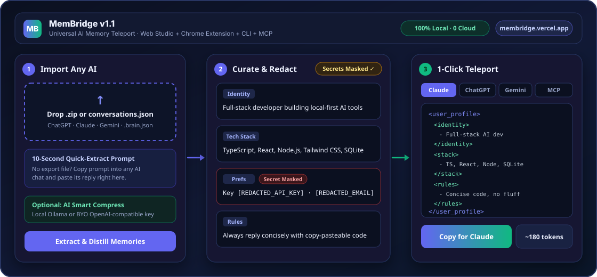

<div align="center">

# MemBridge — Universal AI Memory Teleport

**Move your identity, active projects, tech stack, preferences, and rules across ChatGPT, Claude, Gemini, DeepSeek, Grok, and coding agents in 1 click — 100% locally with zero dependencies.**

[](https://membridge.vercel.app)
[](https://github.com/hyik007/membridge/actions/workflows/test.yml)
[](https://github.com/hyik007/membridge/releases/latest)
[](LICENSE)

[](https://glama.ai/mcp/servers/hyik007/membridge)

<br />



</div>

---

## Why MemBridge?

Switching from **ChatGPT -> Claude -> Gemini -> DeepSeek** shouldn't force you to re-explain who you are, your tech stack, and every active project from scratch.

| Feature | One-off Scripts | Vector DB / Cloud Memory | **MemBridge v1.1** |
|---|---|---|---|
| Non-technical Web Studio (zero install) | No | No (needs DB/cloud account) | **Yes — [membridge.vercel.app](https://membridge.vercel.app)** |
| Direct `.zip` drop (ChatGPT / Claude exports) | Manual unzip | Manual unzip | **Built-in browser unzip (0 deps)** |
| Works across *all* major AIs | Usually 1 -> 1 | Coding tools only | **N-to-N (Claude, ChatGPT, Gemini, DeepSeek, MCP)** |
| Persistent cross-agent MCP memory | No | Cloud / heavy setup | **`membridge_remember` & `membridge_recall` (`~/.membridge/brain.json`)** |
| Optional AI Smart Compress | No | Paid cloud | **Local Ollama or BYO Key (direct from browser)** |
| Auto-redacts API keys & emails | No | No | **Built-in secret masker (`sk-...`, `ghp_...`, AWS, emails)** |
| Dependencies & Telemetry | Heavy | Cloud tracking | **0 npm dependencies · 100% local** |

---

## Quick Start (4 Ways to Use)

### 1. Zero-Install Web Studio (Easiest for Everyone)
Open **[membridge.vercel.app](https://membridge.vercel.app)**, double-click `index.html`, or run locally:

```bash
npm start
# Opens at http://127.0.0.1:4321
```

1. **Import:** Drop your official **ChatGPT/Claude `.zip` export**, `conversations.json`, `.brain.json`, or paste the built-in **10-Second Quick-Extract Prompt** output from any AI chat.
2. **Curate & Redact:** Toggle, edit, recategorize, auto-mask accidental secrets, or run optional **AI Smart Compress** via local Ollama.
3. **1-Click Teleport:** Export cleanly formatted for **Claude XML**, **ChatGPT Custom Instructions**, **Gemini Saved Info**, **DeepSeek/Grok**, **`MEMORY.md`**, or **`.brain.json`**.

### 2. Chrome / Edge Browser Extension (In-Tab Teleport)
1. Download `membridge-chrome-extension.zip` from **[Releases](https://github.com/hyik007/membridge/releases/latest)** (or use the `extension/` folder).
2. Open `chrome://extensions` (or `edge://extensions`), enable **Developer mode**, and click **Load unpacked**.
3. Visit ChatGPT, Claude, Gemini, or DeepSeek -> click **Extract Brain** -> switch tabs -> click **Inject Into Chat**.

### 3. Developer CLI
```bash
# Try the built-in demo
node bin/cli.js demo --to claude

# Convert a ChatGPT export into a Cursor / Antigravity MEMORY.md
node bin/cli.js conversations.json --to markdown --out MEMORY.md

# Convert a .brain.json backup for Gemini
node bin/cli.js membridge.brain.json --to gemini
```

### 4. Persistent MCP Server (Claude Desktop, Cursor, Antigravity, Windsurf)
MemBridge ships a zero-dependency [Model Context Protocol](https://modelcontextprotocol.io) server over stdio with **5 tools**:

| Tool | What it does |
|---|---|
| `membridge_remember` | Save a durable memory fact into `~/.membridge/brain.json` (auto-categorized & redacted) |
| `membridge_recall` | Search saved memories by keyword/category and optionally format for any target AI |
| `membridge_extract` | Extract and categorize memories from text, `conversations.json`, or `.brain.json` |
| `membridge_format` | Convert memories into a ready-to-paste pack for `claude`, `chatgpt`, `gemini`, `deepseek`, `markdown`, or `json` |
| `membridge_redact` | Mask API keys, tokens, and emails in any text |

Add to your MCP config:
```json
{
  "mcpServers": {
    "membridge": {
      "command": "node",
      "args": ["/absolute/path/to/membridge/bin/mcp.js"]
    }
  }
}
```

---

## FAQ & Privacy

**Does MemBridge upload my chats anywhere?**
No. `.zip` unzipping, parsing, categorizing, and secret redaction all run 100% locally in your browser (or in Node for CLI/MCP). The optional AI Smart Compress only calls the endpoint you explicitly choose (such as `localhost:11434` for local Ollama).

**Are my API keys safe?**
Secret redaction is enabled by default and masks `sk-...`, `ghp_...`, `AIza...`, AWS keys, bearer tokens, and emails before copying, downloading, or saving.

## Run Tests
```bash
npm test
```

## Credits
Built by **Hong Yik ([@hyik007](https://github.com/hyik007))** with AI pair-programming via **Google Antigravity**.

## License
MIT — If MemBridge saved you time, a **Star ⭐** helps more people discover it!
