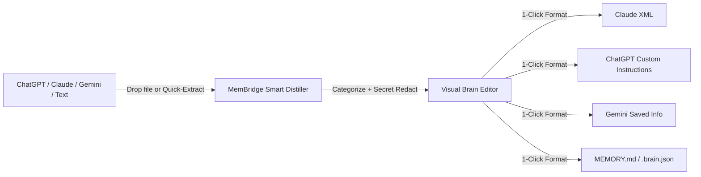

# MemBridge — Universal AI Memory Teleport

[](https://github.com/hyik007/membridge/actions/workflows/test.yml)
[](https://github.com/hyik007/membridge/releases/latest)
[](https://membridge.vercel.app)
[](LICENSE)

Move your **identity, active projects, tech stack, preferences, and rules** across **ChatGPT, Claude, Gemini, DeepSeek, Grok, and coding agents** in 1 click—**100% locally** in your browser with zero cloud uploads.

**Live App:** https://membridge.vercel.app



## Why MemBridge?

| Feature | One-off Scripts | Vector DB / MCP Servers | **MemBridge** |
|---|---|---|---|
| Non-technical UI (Zero setup) | No | No (needs Docker/DB) | **Yes (Web Studio + Extension)** |
| Works across *all* major AIs | Usually 1 -> 1 | Coding tools only | **N-to-N (ChatGPT, Claude, Gemini, DeepSeek, Agents)** |
| Compresses noisy chat logs | Raw dumps | Raw chunks | **Smart signal extraction & token meter** |
| Auto-redacts API keys & emails | No | No | **Built-in secret masker** |
| 100% local & zero dependencies | Mixed | Often needs API keys | **Yes — 0 npm dependencies** |

---

## Quick Start (3 Ways to Use)

### 1. Zero-Install Web Studio (Easiest for Everyone)
Double-click `index.html` directly in your browser **or** start the local server:

```bash
npm start
# Opens at http://127.0.0.1:4321
```

1. **Import:** Drop `conversations.json` (from ChatGPT/Claude), `.brain.json`, or paste the built-in **10-Second Quick-Extract Prompt** output from any AI chat.
2. **Curate:** Toggle, edit, recategorize, and auto-mask accidental secrets (`sk-...`, `ghp_...`, emails).
3. **Teleport:** Pick **Claude**, **ChatGPT**, **Gemini**, **DeepSeek / Grok**, **`MEMORY.md`**, or **`.brain.json`** and click **Copy**.

### 2. Chrome / Edge Browser Extension (In-Tab Teleport)
1. Open `chrome://extensions` (or `edge://extensions`) and turn on **Developer mode**.
2. Click **Load unpacked** and select the `extension/` folder.
3. Visit ChatGPT, Claude, Gemini, or DeepSeek -> click **Extract Brain** -> switch to another AI -> click **Inject Into Chat**.

### 3. Developer CLI
```bash
# Try the built-in demo
node bin/cli.js demo --to claude

# Convert a ChatGPT export into a Cursor / Antigravity MEMORY.md
node bin/cli.js conversations.json --to markdown --out MEMORY.md

# Convert a .brain.json backup for Gemini
node bin/cli.js membridge.brain.json --to gemini
```

### 4. MCP Server (use MemBridge from Claude Desktop, Cursor, Antigravity, etc.)
MemBridge ships a zero-dependency [Model Context Protocol](https://modelcontextprotocol.io) server over stdio. It exposes three tools:

| Tool | What it does |
|---|---|
| `membridge_extract` | Extract and categorize memories from text, a `conversations.json`, or a `.brain.json` |
| `membridge_format` | Convert memories to a ready-to-paste pack for `claude`, `chatgpt`, `gemini`, `deepseek`, `markdown`, or `json` |
| `membridge_redact` | Mask API keys, tokens, and emails in any text |

Add it to your MCP client config:
```json
{
  "mcpServers": {
    "membridge": {
      "command": "node",
      "args": ["/absolute/path/to/membridge/bin/mcp.js"]
    }
  }
}
```
Then ask your assistant: *"Use membridge to convert ~/Downloads/conversations.json into a Claude memory pack."*

---

## Open `.brain.json` Format
```json
{
  "version": "1.0",
  "format": "membridge.brain.json",
  "exportedAt": "2026-11-18T00:00:00.000Z",
  "memories": [
    {
      "id": "mem_0_1a2b",
      "category": "identity",
      "text": "Full-stack developer building local-first AI tools",
      "source": "chatgpt-json",
      "enabled": true
    }
  ]
}
```

## FAQ & Privacy

**Does MemBridge upload my chats anywhere?**
No. Parsing, categorizing, and redaction all run locally in your browser (or in Node for the CLI). There are zero runtime dependencies and no network calls.

**Which exports are supported?**
ChatGPT `conversations.json`, Claude `conversations.json`, `.brain.json`, Markdown, and plain text. Gemini/Takeout JSON is handled by a generic parser.

**Are my API keys safe?**
Secret redaction is on by default and masks `sk-...`, `ghp_...`, `AIza...`, AWS keys, bearer tokens, and emails before anything is copied or downloaded.

## Run Tests
```bash
npm test
```

## License
MIT
